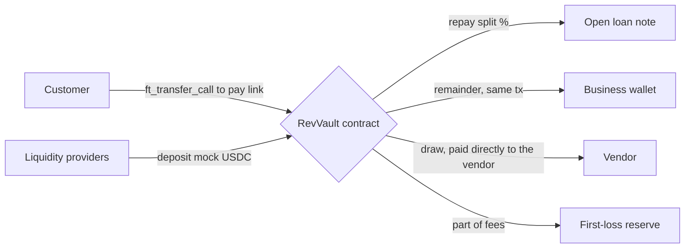

# RevVault: credit that repays itself

Revenue-routed credit for AI businesses on **NEAR**. A customer pays through a RevVault pay link, the contract splits that payment inside the same transaction (part repays the open loan, the rest goes straight to the business), and the credit limit comes from the revenue that really flowed through the contract. The loan is paid straight to a vendor account named at draw time; the contract rejects the borrower's own account as payee. No repay button, no keeper, no off-chain bookkeeping.

Built for the NEAR Hackathon. Tracks: **04 Autonomous Business** (primary), **08 Real-World Money**.

- **Live app:** https://jeremyweb3.github.io/revvault/ (static build, reads the testnet contracts)
- **AI reviewers / agents:** start with [`AGENTS.md`](AGENTS.md) (map, verification, what is not claimed) and [`llms.txt`](llms.txt). One command checks the on-chain claims: `bash scripts/verify-onchain.sh`

> Testnet prototype. Mock USDC. Unaudited. Repayment is economic, not legal. APY is illustrative. Every limit is listed in [Honest limits](#honest-limits).



## Verify it in 2 minutes (for reviewers and agents)

Everything below is checkable without a wallet and without trusting this README.

**1. Read the live contracts** (NEAR testnet, public RPC). The one-command version is `bash scripts/verify-onchain.sh`, which asserts the numbers below and prints PASS/FAIL. The manual version, with amounts in micro-USDC (6 decimals):

```bash
RPC=https://test.rpc.fastnear.com
V=revvault.revvault-dep-17094.testnet
view(){ curl -s $RPC -H 'content-type: application/json' -d "{\"jsonrpc\":\"2.0\",\"id\":1,\"method\":\"query\",\"params\":{\"request_type\":\"call_function\",\"finality\":\"final\",\"account_id\":\"$V\",\"method_name\":\"$1\",\"args_base64\":\"$(printf '%s' "$2" | base64 -w0)\"}}" | python3 -c "import sys,json;print(bytes(json.load(sys.stdin)['result']['result']).decode())"; }
view get_vault_stats '{}'
view get_credit '{"account":"biz-agent.revvault-dep-17094.testnet"}'
view get_notes '{}'
```

Output when this README was written (2026-11-15):

```json
{"tvl":"10007500000","cash":"9807500000","reserve":"7500000","utilisation_bps":199,"illustrative_apy_bps":18,"open_loans":1,"delinquent":0,"total_shares":"10000000000"}
{"limit":"1280000000","available":"1280000000","outstanding":"0","trailing_revenue":"3200000000","advance_rate_bps":4000,"repay_share_bps":9000,"status":"active","kind":"agent", ...}
[{"id":"ln_002","kind":"creator","principal":"200000000","status":"open", ...}, {"id":"ln_001","kind":"agent","principal":"500000000","repaid":"515000000","status":"settled", ...}]
```

What that shows: the limit `1,280` USDC is exactly 40% (`advance_rate_bps: 4000`) of the `3,200` USDC routed through the pay link (`trailing_revenue`). Loan `ln_001` drew 500 USDC, was repaid 515 (500 plus the flat 3% fee) by payments through the split, and is `settled`. Loan `ln_002` is still open.

**2. Build and run the app**

```bash
cd web
npm install
npm run dev                          # http://localhost:5173
npm run typecheck && npm run lint && npm run build
```

The app has no mock mode: it reads the same contracts as step 1 and shows loading, empty, error and RPC-down states. You can browse it without a wallet. To sign transactions use a **throwaway testnet account** (mainnet accounts are refused).

**3. Follow the money on the explorer.** Every deploy, deposit, draw and repayment of the seeded loop has a transaction hash in [`deployments/testnet.json`](deployments/testnet.json) and [`STATUS.md`](STATUS.md). Start at https://explorer.testnet.near.org/accounts/revvault.revvault-dep-17094.testnet

## Claim → evidence

| Claim | Where to check it |
|---|---|
| The limit is computed from routed revenue only | `get_credit` above (`trailing_revenue`, `advance_rate_bps`); `contracts/revvault/src/lib.rs` (`uw_limit`) |
| A draw is paid straight to the vendor account, and the borrower's own account is rejected as payee | draw tx `ln_001` in [`STATUS.md`](STATUS.md); the `invalid vendor` check in `request_draw`, `contracts/revvault/src/lib.rs` |
| Repayment happens inside the customer's payment (`ft_on_transfer`) | repay tx in [`STATUS.md`](STATUS.md) (one 800 USDC payment repaid 515); `ft_on_transfer` in `contracts/revvault/src/lib.rs` |
| Fee is a flat 3% | `fee_bps: 300` in `contracts/revvault/src/lib.rs`; note `ln_001` (500 principal, 15 fee) |
| LPs fund the vault and a first-loss reserve takes the first loss | `get_vault_stats` (`reserve`), Notes and Vault page in the app |
| Terms are fixed in the contract, not negotiated per loan | `fee_bps`, per-business cap and repay split in `contracts/revvault/src/lib.rs`; the Loans page shows them |
| Nothing is claimed that was not run | [Honest limits](#honest-limits) below |

## What the app does

`web/` is a Vite + TypeScript app (wallet via `@hot-labs/near-connect`, testnet only).

- **Dashboard**: one guided path (connect, create pay link, get paid, draw, repay) with a single next action, available credit, active loan, repay split and a 30-day routed-revenue chart.
- **Loans, Pay links, Notes and Vault**: loan terms, a pay link with a payment preview, revenue notes as inspectable tickets, vault TVL, reserve and the LP position.
- **Write paths built**: mint test USDC, USDC storage registration, LP deposit and withdraw, pay through the link, draw, poke a loan, register as a business. Each waits for the final transaction status and links to the explorer.
- Accessibility pass: axe-core reported 0 violations on all pages at 1440 and 375 px; keyboard path, focus handling and live status regions are in place.

## Why NEAR

Atomic fungible-token callbacks (`ft_on_transfer`) make "split the payment while it lands" a single transaction. Named accounts and function-call keys fit an agent that calls `request_draw` without holding a full-access key (described in `docs/tech/contracts-spec.md`; not demonstrated by the seed script). Sub-accounts model each business and vendor cleanly. NEAR Intents is the intended vendor payout adapter for other chains (see the limits for what is and is not proven).

## Repository layout

| path | what |
|---|---|
| `contracts/` | RevVault and mock USDC contracts (Rust, near-sdk 5.x) |
| `web/` | the app and the landing page |
| `scripts/` | deploy, seed, demo agent, NEAR Intents dry quote (`near-api-js`) |
| `deployments/` | testnet deployment record with transaction hashes |
| `docs/` | PRD alignment, research, contract spec, UI direction |
| `prototype/` | the original static mock, kept for reference |
| `demo-assets/video/` | the scripts that recorded and rendered the demo video (Remotion) |

Other commands: `cargo check` (Rust, not re-run for this README), `cd scripts && npm install && node deploy.ts --dry-run` and `node seed.ts --dry-run` (live mode needs a deployer key file that is never in the repo). There are no test suites in this repo by owner decision; the checks are `cargo check`, eslint, `tsc --noEmit` and the live testnet loop.

## Demo

The demo video (1:54) is posted on X, tagged @NEARProtocol and #NEARHackathon: https://x.com/cevintwc/status/2121689935447273897 . It was recorded read-only against the testnet deployment: it shows live reads, not signed transactions.

## Honest limits

- Only revenue routed through the RevVault pay link counts as collateral. Revenue paid anywhere else is invisible to the vault. Meta transactions do not redirect revenue.
- Repayment is economic, not legal. A business can stop routing; its limit then shrinks and the reserve takes the first loss.
- The 30-day revenue history on testnet is seeded demo data that landed on one chain day, not live history. USDC is a mock token with an open faucet.
- APY is illustrative and comes from fees only.
- There is no on-chain vendor allowlist and no max-draw setting. The borrower names the vendor; the contract only rejects the business itself, the vault and the token contract as payee. A colluding second account can still receive a draw.
- Wash-routing can inflate a limit. The damage is bounded by the per-business cap (2,000 USDC) and the mock token.
- A customer payment is not applied to a loan while that draw's vendor transfer is still pending.
- NEAR Intents has no testnet. Testnet vendor payouts are direct token transfers. `scripts/intents/dry-quote.ts` only asks the mainnet quote API for a preview and moves no funds. This project does not claim a testnet Intents payout.
- The web app's write paths were built but not exercised end to end, because that needs a throwaway wallet to sign. The seeded loop above was executed with scripts.
- The contracts are not audited. Admin keys are throwaway testnet keys.
- Positioning: potentially first-of-its-kind. We did not find a NEAR-native revenue-routed credit line for agent businesses in public ecosystem listings. That is absence of evidence, not proof. bond.credit lists NEAR; see the competitor notes in `docs/research/`.
