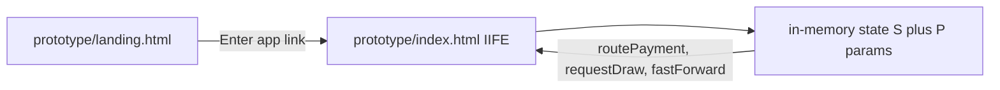
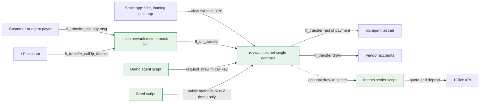
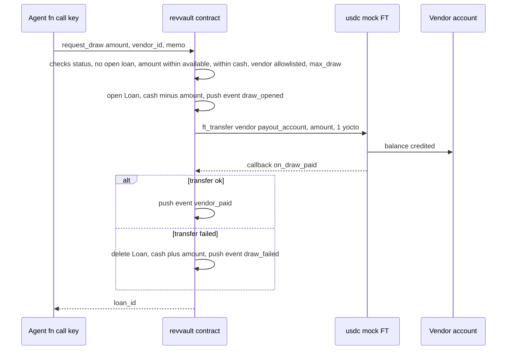
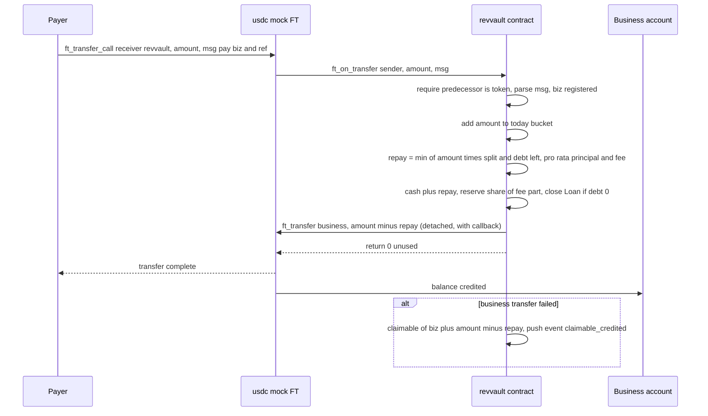
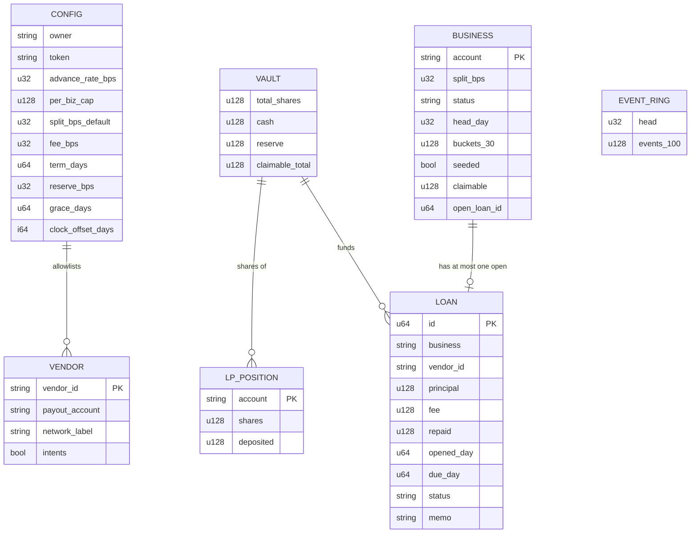
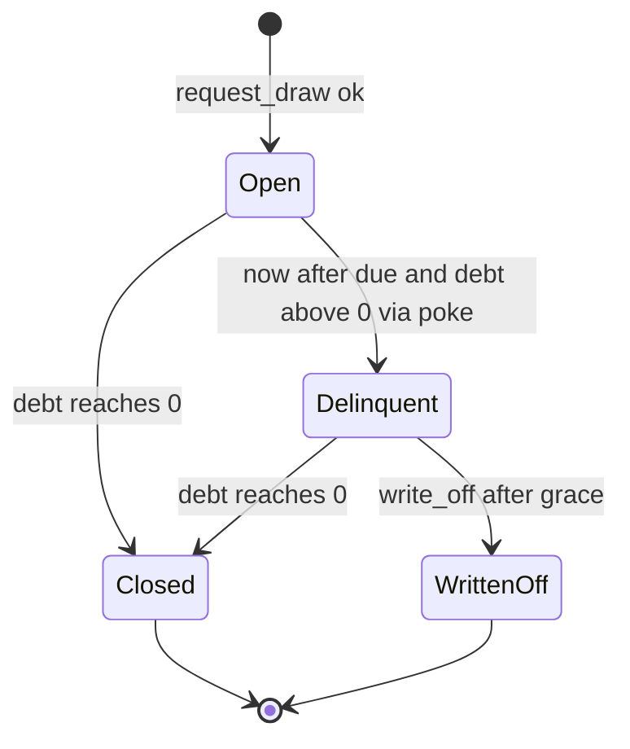
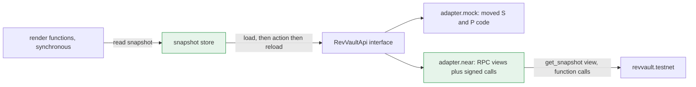

# RevVault 10-day plan: architecture

Back to the plan: [../2026-11-04-revvault-10-day-plan.md](../2026-11-04-revvault-10-day-plan.md)

Scale tier: **MVP** (hackathon, testnet, a handful of judges and one screener). Signal: no real funds, no
users, a fixed deadline. No new infrastructure is added beyond what the plan names. The "scale" questions that
matter for a contract are concurrency, idempotency, and accounting, so the checklist at the end is adapted to a
contract plus static front end.

## Current state (what exists on 2026-11-04)

There is no backend and no contract. `prototype/index.html` is a single IIFE that keeps all state in the
in-memory object `S` and runs the contract math in the browser (`prototype/index.html:299-358`: `routePayment`,
`requestDraw`, `fastForward`). Renderers are synchronous string templates (`render()` at line 377 sets
`#main.innerHTML`). `prototype/landing.html` links into `index.html#/business`.

_Caption: today everything is one file and one object. Nothing here is on chain._

Two things in the prototype that the contract design must not copy:

1. `requestDraw` (`index.html:347`) overwrites `S.loan`. A second draw while a loan is open silently erases debt.
   The hero button at `index.html:427` is enabled whenever `avail() >= 10`, so the bug is reachable. The contract
   rule is **one open loan per business**; the UI must disable Draw while a loan is open.
2. The vault has no write-off path (`business_delinquent` only flips a flag). LPs need a defined loss rule. See
   "Lifecycle" below.

## Proposed architecture (one contract, three modules)

_Caption: green nodes are new. Money moves only through the mock FT. The dotted path (Intents settler) is the
stretch in the cut list; the solid path to `vendor` is the reliable one._

Modules inside `rv` (separate Rust files, one deployed wasm): `router` (ft_on_transfer pay path, ledger buckets),
`credit` (limit, draw, repay, write-off math, pure functions, unit-testable without a sandbox), `vault` (LP shares,
cash, reserve, NAV), plus `events` (ring buffer plus NEP-297 logs) and `admin` (params, vendor allowlist, demo-only
methods behind a cargo feature).

## Main flow 1: draw (agent pays a vendor)

_Caption: state is changed before the outgoing transfer and rolled back in the callback. The vendor, never the
borrower, receives the money (risk R4 in docs/research/02-novelty-and-risks.md)._

## Main flow 2: self-repaying payment

_Caption: the payer's transfer completes even if the forward to the business fails; the failure branch credits an
internal claimable balance that the business can pull. Unknown business: ft_on_transfer returns the full amount
and the FT refunds the payer._

## Data model (contract storage)

_Caption: `buckets_30` is a fixed `[u128; 30]` ring indexed by day, so `trailing_30d` is a 30-element sum and no
unbounded storage grows per payment. `EVENT_RING` is a bounded 100-entry buffer that feeds the UI activity feed
without an indexer._

| Key | Type | Why |
|---|---|---|
| `businesses` | `LookupMap<AccountId, Business>` | `get_credit`, pay path; no iteration needed |
| `loans` | `LookupMap<u64, Loan>` plus `loan_count` | loan detail by id; per-business history via `Business.loan_ids` capped to the last 20 |
| `lps` | `LookupMap<AccountId, LpPosition>` | `get_lp` |
| `vendors` | `LookupMap<String, Vendor>` plus a `Vec<String>` id list | draw drawer vendor list |
| `events` | `Vector` used as a 100-slot ring | `get_events(limit)` for the feed |
| `book` | `Vector<AccountId>` of businesses (append only, small) | `get_loan_book` for the LP table; fine at demo scale |

Accounting uses internal counters (`cash`, `reserve`, `claimable_total`, per-loan principal), never
`ft_balance_of(self)`. Tokens sent straight to the contract without `ft_transfer_call` are ignored, so a donation
cannot move the share price.

## Lifecycle

_Caption: `Delinquent` is set by a permissionless `poke(biz)` so no keeper is needed. A delinquent business has limit 0
and cannot draw. `write_off(loan_id)` is the missing LP-loss rule: the remaining principal is covered first by
`reserve`, the rest lowers NAV._

Business status: `Active` -> `Delinquent` (poke) -> `Active` again when the loan closes; `Paused` is an owner action
that stops draws and routing-to-repay (payments still pass through to the business).

## Frontend adapter swap

_Caption: the renderers stay synchronous because they only read a cached snapshot. Only the store and the adapter are
async. One contract view `get_snapshot(biz, lp)` returns credit, open loan, 30-day ledger, vault stats, LP position
and the last events in a single RPC call, so the UI never shows a torn state._

## Horizontal-scaling checklist (adapted: contract plus static front end)

| # | Check | Result | How |
|---|---|---|---|
| 1 | Stateless app tier | OK | Static files only; no server state. |
| 2 | Session and auth | fixed in design | No sessions. Contract auth is `predecessor_account_id`; agent uses a function-call key limited to `request_draw`. |
| 3 | Source of truth | OK | Contract owns money and ledger; the UI snapshot is a cache reloaded after every action. |
| 4 | Concurrency | fixed in design | NEAR receipts run sequentially per contract; state is updated before outgoing transfers, so two draws cannot both pass the limit. |
| 5 | Idempotency | fixed in design | `ref` in the pay msg is logged; duplicate refs are allowed (customers may repeat) but `request_draw` is blocked by one-open-loan. Seed script checks state before acting. |
| 6 | Connections | N/A | Public RPC only. Use a fallback RPC list in the adapter. |
| 7 | Query shape | fixed in design | Fixed-size ring buckets, capped loan list, bounded event ring, no unbounded iteration in views. |
| 8 | Caching | OK | Client snapshot, reloaded after each action and on a 5 s timer in live mode. |
| 9 | Async work | fixed in design | Outgoing transfers use callbacks with rollback or claimable credit. |
| 10 | Hot keys | accepted risk | One contract is a single hot account; irrelevant at hackathon volume. |
| 11 | Rate limits and abuse | fixed in design | `max_draw` per loan, per-business cap, one open loan, mock-token faucet capped per account per day. |
| 12 | Failure modes | fixed in design | See table below. |
| 13 | Observability | fixed in design | NEP-297 JSON events plus the in-contract event ring; explorer links in the UI. |
| 14 | Data growth | fixed in design | Rings and caps above; nothing grows per payment. |
| 15 | Rollout | fixed in design | Fresh deploy each iteration on a dev sub-account; no migration. Demo-only methods behind `--features demo`. |

## Failure modes

| Failure | Effect | Handling |
|---|---|---|
| Vendor `ft_transfer` fails (unregistered receiver, gas) | Loan opened but vendor unpaid | Callback deletes the loan, restores `cash`, emits `draw_failed`. Seed script pre-registers every vendor with `storage_deposit`. |
| Business `ft_transfer` fails | Business short of funds | Callback credits `claimable`; `withdraw_claimable` pulls it. |
| Payer sends to an unregistered business | Pay msg rejected | `ft_on_transfer` returns the full amount; FT refunds. |
| Gas too low on `ft_transfer_call` chain | Receipt fails, FT refunds payer | UI/agent attach 100 Tgas; contract uses fixed budgets for callbacks (values to be tuned in sandbox tests). |
| Public RPC down or rate limited | Live mode shows stale data | Adapter retries across two RPC endpoints, then shows a "live data unavailable, showing mock" banner. Mock mode is always available. |
| Demo account key rotated by a vandal | Live demo buttons fail | `scripts/seed-testnet` recreates accounts; hosted app defaults to mock mode. |
| Time-dependent states (past due) | Cannot be reached on testnet in real time | Demo-only `set_clock_offset_days`, shown by `NetworkBadge` as "demo clock". |
