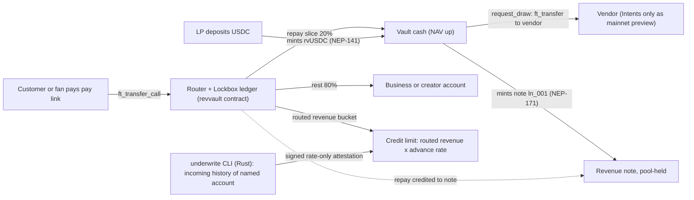
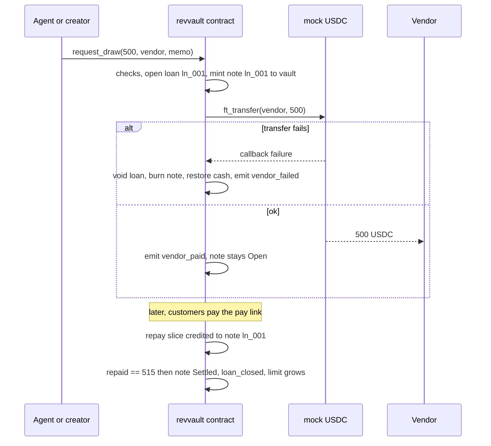

# RevVault: reconcile the plan and prototype with the root PRD

- **Date**: 2026-11-08 · **Project**: RevVault RWA (NEAR Hackathon, deadline 14 Nov 2026 23:59 UTC, aim to submit Fri 13 Nov or Sat 14 Nov by 12:00 UTC) · **Mode**: Smart contract / web3, Feature build, Business (positioning)
- **Status**: draft (decisions unconfirmed). The planning agent could not ask questions, so every decision below is a recommendation. A builder must put Q1-Q4 to Candra before starting. Section "Locked decisions" becomes locked only after he answers.
- **Companion files**: none (single-file plan, as requested). Builds on [2026-11-04-revvault-10-day-plan.md](./2026-11-04-revvault-10-day-plan.md) and amends it where stated.

## Context

What I read (2026-11-08): `PRD.md` (root, Indonesian, user's source of truth), `README.md`, `CLAUDE.md`, `docs/PRD.md`, `docs/tech/{contracts-spec,architecture,open-questions}.md`, `docs/handoffs/{00-overview,contracts,01-contracts,03-demo-agent,STATUS,DEPS}.md` plus headers of `02-frontend.md` and `04-submission.md`, `docs/research/{01-competitive-landscape,02-novelty-and-risks}.md`, `docs/brainstorm/2026-11-04-revvault-10-day-plan.md` and its `pitch-and-demo.md`, and `prototype/index.html`, `prototype/landing.html` (grep plus the state/math block at `index.html:298-358`).

Facts that shape this plan:
- **Nothing is built.** There is no `contracts/`, `app/`, `web/`, `scripts/` directory and no git repo in `revvault-rwa/`. `docs/handoffs/STATUS.md` says no implementer was dispatched. Only the HTML prototype exists. So "6 days" is 6 days from zero for all Rust code, not a refactor.
- **Two plan sets already disagree** and neither was executed: the hackathon-pm handoffs (`docs/handoffs/*`: Next.js port, starter limit 100 USDC, split 20%, reserve 10%, roles R1-R4) versus the 11-04 brainstorm (Vite wrap of the prototype, no starter limit, split 25%, reserve 50%, term clear-math fix). The prototype itself still runs 25% split, reserve 10%, term 30 days (`prototype/index.html:299,308`).
- **The root PRD wants more than either plan.** It says RevVault "mentokenisasi arus kas masuk", targets "bisnis AI otonom dan kreator digital", and names three modules: underwriting engine (Rust) over the incoming tx history of `biz-agent.near`, a lockbox sub-account with auto-repay splitter paying the vendor via NEAR Intents, and a Revenue Note Dashboard where LPs fund pools of receivables. Tech list: NEAR Intents, Meta Transactions, Named Sub-Accounts, Chain Signatures.
- **Honesty constraints are fixed** (CLAUDE.md): only routed revenue is collateral; meta-tx does not redirect revenue; Intents has no testnet; not provably first; APY illustrative; repayment economic not legal; demo is mock until contracts are wired. Machine limit: 14 GB RAM, so no two heavy builds in parallel.

## The question

Make the project match the PRD as closely as is honest and feasible in 6 days: add real tokenization of the cash flows, make creators a real target, map the three PRD modules to contracts and to real-versus-mock demo behaviour, settle the split (20% vs 25%), fix the copy, and re-order the build with a cut line.

## Decision

**Recommendation: keep the existing single-contract loop, and add three PRD-visible layers on top of it, each with a hard fallback: (1) a revenue note per loan (NEP-171 token, pool-held) plus LP shares as NEP-141; (2) a `kind` field (agent or creator) with one seeded creator borrower and creator copy; (3) a pure-Rust underwriting crate plus an off-chain `underwrite` CLI over the named account's incoming history, whose signed attestation can only raise the advance rate, never the revenue base.** Split moves to 20% (matches PRD and `contracts.md`) with term 60 days and a clear-time warning. Meta transactions, Chain Signatures and a real Intents payout are not built and are described as such.

Why this beat the alternatives: the PRD's differentiator is "tokenized income", and today nothing is a token. The cheapest honest version is not a market; it is a token that records the claim and follows the repayment stream. Everything else in the PRD is either already in the loop (router = lockbox, draw = vendor payout) or can be shown truthfully with a labelled fixture. What would change my mind: if Q1 shows no Rust capacity (agents cannot get the core loop green by Tue 10 Nov), drop to the fallback line in section 7 and ship notes as views over contract state.

### Locked decisions (proposed; locked after Candra confirms Q1-Q4)
- **D1 Tokens.** Each draw mints a revenue note, an NEP-171 token whose `token_id` equals the loan id (`ln_001`). Holder defaults to the vault contract. The note entitles its holder to the loan's repayment stream (principal plus fee, up to `debt`), nothing else. LP shares are an NEP-141 token (`rvUSDC`) implemented inside the same contract. Neither token is a regulated security or a legal claim; both are economic claims recorded in the contract.
- **D2 Note transfer is off in the MVP.** `nft_transfer` on a vault-held note panics with a clear message. The `holder` field and a `claimable` map exist so a later buy-at-par is a small change (P2, not scheduled).
- **D3 Creators.** One enum `Kind { Agent, Creator }` on the business record, per-kind advance rate (agent 40%, creator 30%), one seeded creator borrower, creator pay-link and dashboard copy. No separate creator contract, no off-chain creator income verification.
- **D4 Underwriting.** On-chain credit base stays routed revenue only. A pure Rust crate `underwriting` (shared by contract and CLI) computes a score from incoming transfers; the CLI signs an ed25519 attestation `{biz, advance_bps, valid_until_ms, nonce}`; the contract (P1) verifies it with `env::ed25519_verify` and clamps `advance_bps` to `[base, base + 2000]`. It never creates credit from unrouted inflow and never grants a starter limit.
- **D5 Lockbox.** The lockbox is a per-business ledger account inside the router (single contract), shown in the UI as "Lockbox". It is not a separate NEAR sub-account and the README says so. Named sub-accounts are used for demo identities (`biz-agent.<dev>.testnet`, `luna.<dev>.testnet`, vendor accounts) and the agent holds a function-call key limited to `request_draw`.
- **D6 Split.** Default repay split 20% (2000 bps), term 60 days, past-due step-up to 50%, 14-day grace, reserve 50% of collected fees, no starter limit, flat 3% fee. Math in section 5.
- **D7 Intents.** Unchanged from the 11-04 D5: contract pays with `ft_transfer`; an off-contract mainnet script produces a dry quote (and a ~$2 real payout only if the 1Click JWT exists). UI says "via NEAR Intents" only for a vendor with a recorded proof; otherwise "Direct FT (testnet)" plus a "Mainnet quote preview, no funds moved" block.
- **D8 Not built, stated as roadmap.** NEP-366 relayer (gasless), Chain Signatures, note secondary market, sub-account lockbox deployment, legal enforcement.
- **D9 One canonical plan.** This file amends `docs/handoffs/contracts.md` as the contract spec. For the app, keep the 11-04 D7 (Vite wrap of the prototype, no Next.js port) because a port costs 2-3 days nobody has. `docs/handoffs/02-frontend.md` must be edited accordingly (Q4).
- **D10 PRD.md is not edited.** It stays the user's source. The submission text and README follow the corrected copy in section 6; the unverified novelty claims in the PRD are not copied into any public text.

## Options considered

### Tokenization
| Option | What it is | Verdict |
|---|---|---|
| A0. No token (today) | Revenue is contract state only | Rejected: contradicts the PRD headline. |
| **A1. NEP-171 note per loan (pool-held) plus NEP-141 LP share (chosen)** | Unique receivable per loan, fungible pool share | Recommended. Matches reality: the pool funds many loans, each loan is unique, LPs own the pool pro rata. This is also the market pattern: attn.markets' LP side is a share token (`attnUSD`) over a portfolio of revenue-backed positions ([thegrid.id](https://thegrid.id/profiles/attn_markets), read 2026-11-08, aggregator, medium confidence). |
| A2. NEP-141 per loan | One FT contract per loan | Rejected: a contract deploy per loan, storage and gas, wallet clutter. |
| A3. NEP-245 multi token, one id per loan with fungible amounts | Fractional notes, transferable | Strongest technically (NEP-245 is the standard NEAR Intents uses internally, [docs.near-intents.org](https://docs.near-intents.org/integration/verifier-contract/deposits-and-withdrawals/balances)), rejected for the MVP: wallet and explorer support is thinner and it needs a market to mean anything. Post-hackathon path. |
| A4. Transferable notes plus buy-at-par secondary | Real tradable receivables | Rejected for 6 days (pricing, holder payout path, failure cases). Kept as P2 behind D2. |

| | Impact (PRD match) | Effort in this repo | Risk | Reversibility |
|---|---|---|---|---|
| A1 | High: tokens exist, visible on explorer via `nft_token` and `ft_balance_of` | +1.25 agent-days (note 0.75, share FT 0.5) | Low-medium: FT inside a receiver contract is standard | Easy to add transfer later |
| A3 | Highest | +3 days | High | n/a |
| A0 | None | 0 | Fails the PRD | n/a |

Pre-mortem (it is 15 Nov and this failed, why): (1) core loop not green by Tue because the note and share token were added before the loop passed. Mitigation: gate G1 below is the loop alone; tokens are added after, with a fallback. (2) A judge asks "so I can trade the note?" and the answer is no. Mitigation: the copy says "pool-held in the MVP" and the Q&A in section 6 has the answer. (3) The history score is attacked as using unrouted revenue, contradicting "only routed revenue counts". Mitigation: D4 clamps it to a rate boost and the UI shows "routed share of inflow". (4) Creator story reads as decoration. Mitigation: one real seeded creator loan visible in the notes table.

### Creator support
| Option | Verdict |
|---|---|
| **C1. `Kind` field, per-kind advance rate, seeded creator, copy (chosen)** | Smallest change that is real in contract state and visible in the demo. |
| C2. Full creator flow (tips, sponsor invoices, editing vendors, separate dashboard) | Rejected: UI bloat for a 90 s demo. |
| C3. Copy only, no contract change | Rejected: a creator would be a label, not a target. |

### Underwriting
| Option | Verdict |
|---|---|
| U1. Router-native only | Fully honest but is not "an engine over transaction history", so it fails PRD module (a). |
| **U2. U1 plus Rust crate and CLI over named-account history with a rate-only attestation (chosen)** | Matches the PRD's Rust engine; stays honest by limiting its power. |
| U3. Let the attested score create a starter limit | Rejected: sybil drain; contradicts "only routed revenue counts". |

## Spec

### 1. PRD versus current: gap table

| # | PRD says | Today (prototype plus plans) | Gap | Action (section) |
|---|---|---|---|---|
| 1 | Tokenize future cash flows | No token; revenue only contract state (`contracts-spec.md` State block, `index.html:299-358`) | Core claim missing | Revenue note NEP-171 plus LP share NEP-141 (2) |
| 2 | Targets AI businesses and digital creators | AI only in UI and spec ("Agent constraints", `index.html:424`; landing "Built for agents") | Half the audience missing | `Kind` plus seeded creator plus copy (3) |
| 3a | Rust underwriting engine over incoming tx history of `biz-agent.near`, sets BNPL limit | Router-native limit from routed revenue; attested score is on the cut list (`02-novelty-and-risks.md` R2, `contracts.md` has no attestation) | No engine over account history | `underwriting` crate, `underwrite` CLI, rate-only attestation (4a) |
| 3b | Lockbox sub-account plus auto-repay splitter (e.g. 20%) until principal repaid | Shared router with per-business ledger; split 25% in prototype, 20% in `contracts.md` | Split inconsistent; "sub-account" not literal | Lockbox as ledger account, split 20% (4b, 5) |
| 3b | Disburse to compute/API vendor directly via NEAR Intents | `ft_transfer` on testnet; Intents mainnet dry quote only; prototype labels "via Intents" (`index.html:301,302,352`) | Prototype overclaims | Data-driven vendor labels (4b, 6) |
| 3b | Customer revenue "via Meta Transactions" goes to the lockbox | Wrong mechanic; router pay link is the mechanism | Copy and tech list wrong | Correct in copy (6) |
| 3c | Revenue Note Dashboard: LPs fund pools of receivables | LP Vault page with pool stats only | No per-receivable view | Notes table plus LP share (4c) |
| 4 | NEAR Intents, Meta Tx, Named Sub-Accounts, Chain Signatures | Landing marquee lists all but Chain Signatures (`landing.html:316`) | Marquee claims tech not used | Truth table in section 6 |
| 5 | "First-of-its-kind on NEAR", novelty check "Belum ditemukan", 9.0/10 | Not provable; bond.credit lists NEAR | Unsafe claim | Safe sentence (6) |
| 6 | Winners cited as precedent | `PRD.md` cites Roke.to (MetaBuidl grand prize) and a Devpost "Ping Subscription" project. The words "Colosseum winners" appear only in the earlier pitch noted in `01-competitive-landscape.md`, not in the root PRD | Unverified | Flag, do not cite (Evidence) |
| 7 | (implicit) one coherent plan | Two plan sets disagree (Next.js vs Vite, 20 vs 25, starter limit, reserve) | Builders will diverge | D6, D9 and the edit list (8) |

### 2. Tokenization design

**What is tokenized.** One revenue note per loan. It is a claim on that loan's repayment stream: `principal + fee` collected from the routed split, and only that. It is not a claim on the borrower's total revenue, not on the borrower, and not on the pool.

**Standards.** Notes: NEP-171 core views plus NEP-177-style metadata (`nft_token`, `nft_total_supply`, `nft_tokens_for_owner`, `nft_supply_for_owner`, `nft_metadata`), and the NEP-171 mint event. Shares: NEP-141 via `near-contract-standards` `FungibleToken` in the same contract (symbol `rvUSDC`, 6 decimals), auto-registering the receiver on mint so LPs do not need `storage_deposit`. `ft_on_transfer` (receiver, for mock USDC in) and the share token's `ft_transfer` (out) do not collide.

**Who holds what.**
- Vault contract holds every note. LPs hold `rvUSDC` (pro rata over cash plus outstanding principal, same NAV formula as `contracts.md` §4).
- Borrower holds nothing.
- `Note` sketch (not an implementation):

```rust
// SKETCH ONLY
struct Note {
    id: String,          // equals loan id, e.g. "ln_001"
    biz: AccountId,
    holder: AccountId,   // vault by default
    principal: u128, fee: u128, repaid: u128,
    repay_share_bps: u32,
    minted_ms: u64, due_ms: u64,
    status: NoteStatus,  // Open | Settled | PastDue | WrittenOff
}
```

**Entitlement and redemption.** On every routed payment the `repay` slice is attributed to the note: holder equals vault means it lands in vault cash (raising NAV); a non-vault holder (P2) credits `claimable[holder]`, pulled with `claim_note_proceeds()`. When `repaid == principal + fee` the note becomes `Settled` (kept as a record, not burned). On write-off after grace the note is `WrittenOff` and the reserve, then NAV, absorbs the loss. Redemption for LPs is `lp_withdraw(shares)` against cash, as before (panics with "insufficient liquidity: available X").

**Transfer.** Notes: `nft_transfer` panics ("notes are pool-held in this MVP"). Shares: fully transferable NEP-141. P2 buy-at-par: buyer pays the outstanding principal part to the vault, becomes holder, repayments credit `claimable`.

**Minimal scope for 6 days (priority):**
- P0: `Note` struct, mint at draw, settle at close, NEP-171 view methods and mint event, `get_notes`, `get_note`, note status in `get_snapshot`/views, tests (note minted with the loan, settles at the last payment, owner equals vault).
- P1: LP share as true NEP-141 (`ft_balance_of`, `ft_total_supply`, `ft_transfer`, `ft_metadata`).
- Fallback if P1 slips: shares remain an internal map exposed through read-only `ft_balance_of`/`ft_total_supply`/`ft_metadata`; copy says "share ledger", not "token".
- P2 (not scheduled): transfer and buy at par.

**How to say it honestly.** "Every loan is recorded on-chain as a revenue note (an NEP-171 token) that represents the right to that loan's repayment from the borrower's routed revenue. In this MVP the pool holds the notes and LPs hold pool shares (NEP-141). The notes are economic claims in the contract, not securities, not transferable yet, and repayment is enforced by routing economics, not by law."

### 3. Creator support, smallest real change
- Contract: `register_business({kind})` (owner-curated or self-registration with `storage_deposit`), `Kind { Agent, Creator }`, `advance_bps_for(kind)` (agent 4000, creator 3000). Creators earn lumpier revenue, so a lower advance is the honest risk story. Same router, same pay link, same loan rules.
- Pay link: accepts any `ref`; creator presets are copy only (`tip_`, `sponsor_`, `commission_`).
- Seed: `luna.<dev>.testnet` (creator) with spiky 30-day history and one open loan to a vendor labelled "Render-Farm" (compute), so the notes table shows one agent note and one creator note.
- UI: account chip shows kind; dashboard heading "Agent constraints" becomes "Business constraints" with a creator variant; landing hero line mentions creators; vendor allowlist has a creator vendor.
- Honest limit: only stablecoin payments through the RevVault pay link count. Off-platform income (ad revenue, card payouts) is invisible to the vault.
- Acceptance: `get_credit(luna)` returns kind `creator` and a 30% advance; the Notes table shows both kinds; demo video spends at most 8 seconds on the creator.

### 4. The three PRD modules: contracts, real versus mock


_Caption: money moves left to right; the note is a record that follows the repayment slice. The attestation only touches the advance rate._


_Caption: failure branch voids the note, so no orphan token exists for an unpaid vendor._

#### 4a. Module (a) Underwriting engine
| Part | Honest scope | Real or mock in the demo |
|---|---|---|
| On-chain limit: `min(routed_30d x advance_bps, cap) - owed` | Computed in the contract from the routed ledger. A NEAR contract cannot read account tx history (`02-novelty-and-risks.md` R2). | Real on testnet; history is seeded through `demo`-feature `seed_history` plus a few real pay calls, labelled "seeded history" |
| `underwriting` crate (pure Rust, `no near-sdk`) | `score(inflows) -> {advance_bps, cap, components}`. Inputs: trailing volume, active days of last 30, distinct payers, top-payer concentration, volatility, and **routed share of inflow**. Deterministic, unit-tested with golden vectors. The contract reuses its `limit()` function so there is one formula. | Real code, real tests |
| `underwrite biz-agent.testnet` CLI | Reads incoming FT transfers to the named account, prints the score, emits the attestation. `--source fixture` (default, `deployments/history/biz-agent.json`, generated by the seed script) or `--source rpc` (NearBlocks/FastNEAR testnet API, P1, rate limits unverified, `open-questions.md` #8). | Fixture mode real code on labelled fixture data. Never presented as live history unless `--source rpc` actually ran. |
| `post_attestation(payload, sig)` (P1) | ed25519 verify against `attestor_pk`; clamp `advance_bps` to `[base, base+2000]`; expiry and nonce checked. Never adds revenue, never a starter limit. | Real if built; else "specified, not implemented" |

Why the engine reads unrouted inflow without breaking the rule: it sets the *terms* (rate), not the *collateral* (routed revenue). The UI shows "routed share of your inflow" next to the score, which doubles as the diversion warning (R4). On the pitch: "We read your wallet history to price you; we only lend against revenue that actually flows through the lockbox."

#### 4b. Module (b) Lockbox and auto-repay splitter
| Part | Mapping | Real or mock |
|---|---|---|
| Lockbox | Router ledger account per business inside the single contract; pay link targets the contract with `msg {"action":"pay","biz":...}`. | Real on testnet |
| Auto-repay splitter | `repay = min(ceil(amount x share), debt_left)`, remainder to the business, state before outgoing transfer, rollback callback (`contracts.md` §4). Default 20%. | Real, full tests |
| Vendor disbursement | `ft_transfer` to a registered vendor account. | Real on testnet as direct FT. Intents path: mainnet dry-quote preview, real payout only with a JWT proof (Q3). |
| Named sub-accounts | Demo identities and the agent function-call key limited to `request_draw`. | Real |
| Meta transactions | Not built. Explicitly "does not redirect revenue; gas UX only; roadmap". | Not shown |
| Chain Signatures | Not used. | Not shown |

#### 4c. Module (c) Revenue Note Dashboard
Screen "Notes" (replaces the "LP Vault" nav label with "Notes and Vault"). Wireframe:

```
┌────────────────────────────────────────────────────────────┐
│ Pool: TVL · utilisation · reserve · illustrative APY chip   │
├────────────────────────────────────────────────────────────┤
│ Your share: 1,000 rvUSDC ≈ 1,012 USDC   [Fund pool][Withdraw]│
├────────────────────────────────────────────────────────────┤
│ Revenue notes (pool-held)        filter: All | Agent | Creator│
│ ln_001 biz-agent  Agent  515  ▓▓▓░░ 38%  20% split  Open     │
│ ln_017 luna       Creator 309 ▓▓░░░ 22%  20% split  Open     │
│ ln_009 dataco     Agent  515  ▓░░░░  5%  50% split  Past due │
│ ln_000 shop-bot   Agent  412  ▓▓▓▓▓ 100% Settled            │
├────────────────────────────────────────────────────────────┤
│ "Notes are economic claims in the contract, not securities." │
└────────────────────────────────────────────────────────────┘
```
States: empty ("No notes yet, a draw mints the first"), loading skeleton, RPC error banner with "switch to mock", partial (note minted, vendor pending), success. Reuse the prototype's card, chip and debt-bar classes; one new `NotesTable` component. Row click opens the loan with its note id and explorer link in testnet mode.

### 5. Split decision: 20% versus 25%

Math. Let `T` be trailing 30-day routed revenue, steady. Limit `L = 0.40 T`. Max draw `D = L`. Debt `= 1.03 D`. Daily repay `= s x T/30`. Days to clear a max draw `= 1.03 x 0.40 x 30 / s = 12.36 / s`.

| Split s | Days to clear a max draw | Clears in 30 d? | In 60 d? |
|---|---|---|---|
| 20% | 61.8 | no | borderline (just over) |
| 25% | 49.4 | no | yes |
| 30% | 41.2 | no | yes |
| 40% | 30.9 | no (just) | yes |
| 50% | 24.7 | yes | yes |

Worked demo draw (500, debt 515) on the seeded revenue (about 80 per day average, about 110 per day this week):
| Split | At 80/day | At 110/day |
|---|---|---|
| 20% | 32.2 days | 23.4 days |
| 25% | 25.8 days | 18.7 days |

Findings: (1) at either split a max draw never clears in the 30-day term, as the earlier agent found (about 49 days at 25%). (2) A draw fraction `x` of the limit clears in `12.36 x / s` days, so at 20% a draw up to 48% of the limit clears in 30 days. (3) With term 60 days at 20%, advance 40% and the max draw are almost exactly consistent (61.8 versus 60), so the step-up to 50% past due only has to cover the last days.

**Recommendation: default 20% (2000 bps), term 60 days, show "est. days to clear" and warn when it exceeds the term, past-due step-up to 50%, grace 14 days, reserve 50% of collected fees.** Reasons: it is the PRD's example and the value already in `contracts.md` and its golden vector (payments 500/1000/1500 give repay 100/200/215), so no fixture rewrite; and 60 days makes the max draw safe. Costs: slower self-repay in the demo (handled below) and lower LP annualised yield since the same 3% fee is earned over a longer life: gross about `3% / 60 x 365 = 18.3%` annualised on drawn funds versus 36.5% at 30 days, so the illustrative APY chip must be computed from `term_days` and will drop. Say that on the page.

Demo consequence: the old take buttons (120/250/400) cannot close a 515 loan. Add a "Customer pays 1,000" and a "Simulate a week of sales" action (three payments of 500/1000/1500 reproduce the golden vector and close the loan exactly). What would change my mind: if Candra wants the loan to look faster, use a 25% split and say so; the PRD only says "misalnya 20%".

Also fix in the prototype: a second draw overwrites an open loan (`requestDraw`, `index.html:347`); guard it and disable the button while `S.loan` exists. Reserve default 1000 to 5000 bps (`P.reserveBps`, `index.html:299`; `contracts.md` §2).

### 6. Positioning and copy

**Owner decision 2026-11-08: keep "first" (PRD wording).** Use the "safe sentence" below as the headline, phrased as "potentially the first" / "we found no revenue-routed credit line on NEAR's public dApps" (matches PRD.md). Do not assert it as proven. The no-"first" variant below is kept only as a fallback.

**Headline sentence (fallback, no "first"):** "RevVault is a self-repaying credit line for autonomous AI businesses and digital creators on NEAR: limits come from revenue that already flowed through its pay link, every loan is recorded as a revenue note, and each note repays itself from a share of future payments."

**Safe sentence for README body and pitch (the verbatim phrase from `01-competitive-landscape.md`, extended by one clause, usable only after Candra re-checks bond.credit by eye, Q4 in the 11-04 plan):** "RevVault is the first revenue-routed credit line for autonomous agent businesses and digital creators on NEAR: credit limits come from revenue that already flowed through the vault, and repayment is a programmable split of every future payment." If not re-checked, drop "first".

**Tech truth table (README and landing):**
| PRD tech | Honest statement |
|---|---|
| NEAR Intents | Mainnet dry quote preview and optional ~$2 proof; testnet payout is a direct FT transfer. No testnet Intents claim. |
| Meta Transactions | Not built. They do not redirect revenue; the pay link does. |
| Named sub-accounts | Used for demo identities and the agent's function-call key. The lockbox is a ledger account, not a deployed sub-account. |
| Chain Signatures | Not used. |

**Copy edits needed (file by file):**
- `README.md`: new tagline (headline sentence); "Status" no longer "research phase, no code"; add "Revenue notes and LP shares" section with the honest sentence from section 2; add "Who it is for" (agents and creators, creator limit); add "PRD module map" (3 modules, real vs mock table from section 4); tech truth table; keep the six honesty bullets; add "Seeded history, mock USDC, owner key, not audited"; update the "Decisions I changed" list (item 3 now says underwriting is router-native plus a rate-only attestation).
- `prototype/landing.html`: marquee (`:316`) drop "Meta transactions" and make "NEAR Intents" read "NEAR Intents (mainnet preview)"; hero sub (`:311`) mention creators; module section (`:369-374`) rename the three cards to Underwriting, Lockbox and auto-repay, Revenue notes; the "Vendor-direct payout" chain (`:388`) read Vault, Vendor, with "Intents on mainnet preview" as a caption; "Compare" row "Built for" (`:400`) add creators; "Honest limits" (`:406-410`) add three entries: notes are pool-held economic claims, history score only sets the rate, creator income counts only if routed.
- `prototype/index.html`: `VENDORS` notes (`:301-303`) and `vendor_paid` text (`:352`) become data-driven, no "via Intents" without proof; `split` 0.25 to 0.20 (`:308`); `P.termDays` 30 to 60 and `P.reserveBps` 1000 to 5000 (`:299`); `requestDraw` guard (`:347`); demo take buttons and "Customer pays 1,000"; est-days warning; new Notes view and nav label; account-kind chip; "Agent constraints" (`:424`) to business variant; `TITLES` (`:363`) LP Vault to Notes and Vault; APY from `term_days` (`:326`); pay-link copy (`:447`) creator variant; `:485` "LP shares absorb" stays, add "notes settle or are written off".
- Pitch (`docs/brainstorm/2026-11-04-revvault-10-day-plan/pitch-and-demo.md`): add the note beat to the 90 s script (draw mints note ln_001, final payment settles it), the creator beat (8 s), the underwriting beat (CLI output with "fixture" label), and these Q&A answers: "Can I trade the note?" (not yet, pool-held, designed for it), "Does the score use unrouted revenue?" (only to price the rate), "Is this a security?" (economic claim in a contract on testnet, no yield promise).
- X post and video: never say "first", "tokenized security", "yield", "Intents payout" without proof.

### 7. Revised build order, with cut line

Parallel lanes, but cargo builds run one at a time (14 GB limit). Dates assume Candra answers Q1-Q4 tonight.

| Day | Date | Rust lane | Web lane | Script lane | Gate |
|---|---|---|---|---|---|
| 1 | Sun 8 Nov (tonight) | R4-style skeleton (workspace, toolchain), `cargo near build` hello, `mock-usdc`, pure `credit` and `underwriting` crates with unit tests | Vite scaffold, mock adapter in integer micro-USDC, split 20%, term 60, reserve 50%, draw guard | Apply 1Click key if not done | G0 builds |
| 2 | Mon 9 Nov | Router pay path, draw, callbacks, vault and LP, events, `Kind` | Notes view on mock, demo buttons, est-days warning | Seed script v0 | |
| 3 | Tue 10 Nov | Note mint/settle plus NEP-171 views, then LP share NEP-141, invariant tests | Creator copy, vendor labels data-driven | `underwrite` CLI fixture mode, `deployments/history/*.json` | **G1: full loop plus note lifecycle green in `cargo test`** |
| 4 | Wed 11 Nov | Deploy testnet, `post_attestation` (P1), hardening | Live read adapter, NetworkBadge, error states | Seed testnet with agent plus creator plus 2 others; demo agent | **G2: UI shows real testnet notes** |
| 5 | Thu 12 Nov | Fixes only | Live writes (pay link, draw, LP deposit), landing and README copy pass | Intents dry-quote script; proof only if JWT | **Feature freeze EOD** |
| 6 | Fri 13 Nov | none | Deploy static app | README fresh-clone dry run, 90 s video, X post drafted (Candra approves) | **G3: video approved, G4 README passes** |
| - | Sat 14 Nov | buffer | buffer | Submit by 12:00 UTC (hard limit 23:59) | |

**Cut line, drop in this order (first cut first); never cut: loop, note mint/settle with NEP-171 views, honest copy, `cargo test`:**
1. Note transfer, buy at par (already out, D2).
2. `--source rpc` for `underwrite` (fixture only).
3. `post_attestation` on-chain (CLI still prints the attestation; UI says "specified, not enforced on-chain").
4. Live creator writes (creator stays a seeded, read-only borrower).
5. LP share as true NEP-141 (fallback: read-only share ledger, copy says "share ledger").
6. Real Intents proof (dry quote, then documented-only).
7. Live-mode writes for LP (writes stay in mock).
8. `underwrite` CLI entirely (module (a) becomes "router-native, history engine specified"; remove the history claim from all copy).
9. Last resort: mock-mode app plus contract tests plus read-only testnet, said plainly.

Trigger: if G1 is not green by end of Tue 10 Nov, cut items 1-5 at once and spend Wed on deploy and UI.

### 8. Handoff text and files to edit

**Updated contract-builder handoff** (replaces the relevant parts of `docs/handoffs/01-contracts.md`; prompt in Handoff below). Deltas to `docs/handoffs/contracts.md`:
- §2 params: `repay_share_bps_default` 2000 (keep), `reserve_bps` 1000 to 5000, `loan_term_ns` 30 to 60 days, `starter_limit` 100 to 0, add `advance_bps_creator` 3000, `grace_days` 14, `past_due_split_bps` 5000, `attestor_pk` (optional).
- §3 methods: `register_business({kind})`; note and share views; `nft_*` and `ft_*` standard views; `post_attestation` (P1); `poke`/`write_off` per 11-04 D10; `claim_note_proceeds` stubbed or absent (D2).
- §4: draw mints note; payment credits note; close settles note; failed vendor transfer voids loan and note; term 60 and est-days; past-due step-up to 50%; one formula for limit shared with `underwriting`.
- §5 views: `get_notes({account?, kind?})`, `get_note({id})`, `get_snapshot`; `Credit` gains `kind`, `advanceRateBps`, `effectiveSplitBps`, `dueAt`, `pastDue`, `attested`.
- §6 events: add `note_minted {id, biz, principal, fee, holder}`, `note_settled {id}`, `note_written_off {id}`; NEP-171 mint event as `standard: "nep171"`.
- New invariants: (7) every open loan has exactly one note, held by the vault; (8) sum of `rvUSDC` supply equals `total_shares`; (9) a settled note has `repaid == principal + fee`; (10) no attestation can raise limit above `routed x (base + 2000 bps)`.
- §15 honesty: add "notes are economic claims, pool-held, not securities, not yet transferable" and "the history score sets the rate only".

**Updated frontend-builder handoff**: Vite wrap per D9 (not Next.js); Notes view per 4c; creator kind and copy per 3; honesty copy per 6; adapter types gain `Kind`, `Note`, `snapshot()`, `network()`; vendor labels from data; demo buttons per 5.

**Existing files to edit (exact list):**
1. `docs/handoffs/contracts.md` (§2-§6, §8 types, §15)
2. `docs/handoffs/01-contracts.md` (scope in/out, requirements table, cut order, acceptance criteria 3 and invariants)
3. `docs/handoffs/02-frontend.md` (Next.js to Vite, Notes view, creator, copy)
4. `docs/handoffs/03-demo-agent.md` (creator seed, `underwrite` CLI and history fixture, Intents proof rules)
5. `docs/handoffs/04-submission.md` (README blocks, claims table, video beats)
6. `docs/handoffs/00-overview.md` (role map, demo path with note beat, cut order) and `docs/handoffs/STATUS.md` (new step, this plan)
7. `docs/tech/contracts-spec.md` and `docs/tech/architecture.md` (notes, share token, lockbox wording, underwriting split, split 20 and term 60)
8. `docs/PRD.md` (synthesised PRD: product line, targets, scope, cut order; it must not contradict root `PRD.md`)
9. `docs/research/02-novelty-and-risks.md` (R2 update, new R8 token and regulatory framing) and `01-competitive-landscape.md` (attnUSD share-token precedent, Roketo note, Clipstake still unverified)
10. `docs/ui/01-screens-and-flows.md` and `02-component-inventory.md` (Notes screen, `NotesTable`, kind chip)
11. `docs/03-build-plan.md` (mark superseded by this file) and `docs/brainstorm/2026-11-04-revvault-10-day-plan.md` (mark D3/D9/D10 split 25 as superseded by D6 here)
12. `README.md`, `prototype/index.html`, `prototype/landing.html` (section 6). Do not edit root `PRD.md`.

## Out of scope
Note secondary market and buy at par, NEP-245 notes, sub-account-per-business deployment, NEP-366 relayer, Chain Signatures, a real Intents payout without a JWT, wallet connect (stretch only), starter limits, LP tranches, withdrawal queue, any mainnet deployment, any legal or yield claim, editing `PRD.md`, any code written by the planning agent.

## Open questions

1. **Capacity and canonical plan (blocks Sun night).** The repo has no code and nothing was dispatched. Who writes the Rust (agents with you reviewing, or a teammate), and do you confirm this file plus `contracts.md` as the single plan with the app as a Vite wrap (not a Next.js port)? Recommended: agents write, you review tests; Vite.
2. **Token scope.** Accept pool-held, non-transferable NEP-171 notes plus NEP-141 LP shares (about +1.25 days), or do you need notes to be transferable at par in the demo (about +1 more day, which displaces the underwriting CLI)? Recommended: accept pool-held.
3. **Underwriting and Intents.** Promote the Rust `underwrite` CLI with a rate-only attestation from the old cut list to P1 (about +0.75 day), and do you already have the 1Click Partner Dashboard JWT? Recommended: yes to the CLI; without a JWT the Intents part stays dry-quote only.
4. **Split and wording.** Confirm 20% split, 60-day term, 50% reserve, no starter limit, and that the public text uses the headline sentence without "first" unless you re-check bond.credit by eye. Recommended: yes to all.

## Tooling
- **Installed**: nothing verified or installed by this session (planning agent, no installs). Skills available here that apply: `near-smart-contracts`, `near-contract-audit`, `near-api-js`, `near-intents`, `near-cli-rs`, `code-review`, `x-post`, `vercel:deploy`.
- **Recommended, not installed (from the 11-04 plan, still valid):** `cargo binstall cargo-near`, `cargo binstall near-cli-rs` (confirm crate name on install), `pnpm add near-api-js` in `web/`, `pnpm add @defuse-protocol/one-click-sdk-typescript` in `scripts/` only if Intents proof is pursued. Candra approves each item.
- **Rejected**: new skills or MCP servers; the project is a 6-day sprint and this file plus the handoffs carry the invariants.
- **Needs the user**: funded dev testnet account, 1Click JWT status, public repo name, approval before any X post.

## Evidence
Read on 2026-11-08 unless noted.
- Local: `PRD.md` (whole), `docs/handoffs/contracts.md` §2-§6 and worked example (limit 960, draw 500, fee 15, payments 500/1000/1500 give repay 100/200/215), `docs/handoffs/STATUS.md` (nothing dispatched), `docs/brainstorm/2026-11-04-revvault-10-day-plan.md` (D1-D12, reserve and clear-time findings), `prototype/index.html:299-358` (params, `routePayment`, `requestDraw`), `prototype/landing.html:316,388,400-410`.
- Roketo (the PRD writes "Roke.to"): a NEAR Medium article describes it as a token-streaming service and a MetaBUIDL grand prize winner (2021), per a search result summary; the full winners list was not found ([medium.com/nearprotocol](https://medium.com/nearprotocol/how-to-win-a-near-hackathon-7-tips-from-co-founder-of-roketo-947fbc80ad80)). Confidence medium. The Devpost "Ping Subscription Shade Agent" claim and any Colosseum winner reference are **unverified**: do not cite them as fact.
- attn.markets: aggregators describe revenue-backed credit for Solana creators, repaid from a revenue share, with an LP share token `attnUSD`; no primary source read, no audit announced ([thegrid.id](https://thegrid.id/profiles/attn_markets), [solanacompass.com](https://solanacompass.com/projects/attnmarkets)). Confidence medium-low. Use only as "design analogue".
- NEP-245 is the multi-token standard alongside NEP-141 and NEP-171; NEAR Intents' Verifier uses it as its internal ledger ([github.com/near/NEPs nep-0245](https://github.com/near/NEPs/blob/master/neps/nep-0245.md), [docs.near-intents.org](https://docs.near-intents.org/integration/verifier-contract/deposits-and-withdrawals/balances)). Confidence medium.
- Not verified: bond.credit live on NEAR, Clipstake, Intents JWT lead time, NearBlocks/FastNEAR testnet history API limits, exact near-contract-standards 5.x macro names for an FT that is also a receiver, gas for the draw callback chain with an extra mint.

Assumptions (not evidence): the 6-day estimates above are guesses, not measurements; the seeded revenue averages used in the clear-time table come from the prototype seed, not real data. **Riskiest assumption: agents can get the core loop green by Tue 10 Nov starting from zero code.** A multi-voice `party-mode` red team was not run (sub-agent); a single-pass attack found the clear-time gap, the unrouted-history contradiction (fixed by D4) and the orphan-note case on vendor failure (fixed in the sequence).

## Handoff
- **Agent**: Rust lane `general-purpose` (instruct it to read the NEAR docs cited in `docs/brainstorm/2026-11-04-revvault-10-day-plan/research.md`); web lane `work:frontend`; script lane `general-purpose` after G2. Candra dispatches; this agent did not.
- **Prompt (Rust lane, paste after Candra answers Q1-Q4)**:
```
@agent-general-purpose Read /home/cn/Projects/Competition/Web3/NEAR/revvault-rwa/docs/brainstorm/2026-11-08-prd-alignment.md (sections Decision, 2, 3, 4, 5, 7, 8), then docs/handoffs/contracts.md and docs/brainstorm/2026-11-04-revvault-10-day-plan.md. Build contracts/revvault and contracts/mock-usdc plus a pure crate `underwriting`, single contract, near-sdk 5.30, near-workspaces 0.24, no comments, no unwrap on caller paths, state before outgoing transfers with #[private] rollback callbacks. Order: (1) pure credit and underwriting unit tests; (2) loop: pay router, draw, self-repay, close, LP, delinquency, failed-transfer rollback with split 20%, term 60d, reserve 50%, no starter limit; (3) gate G1: full loop green in `cargo test`; (4) only then revenue notes (NEP-171 views, mint at draw, settle at close, void on vendor failure), Kind with per-kind advance, then rvUSDC as NEP-141 in the same contract; (5) post_attestation (P1). Honour the cut line in section 7 and the new invariants 7-10. Report measured gas and any deviation. Do not touch prototype/ or existing docs except the contract-spec files listed in section 8, and request dependencies via docs/handoffs/DEPS.md.
```
- **Prompt (web lane)**:
```
@agent-work:frontend Read /home/cn/Projects/Competition/Web3/NEAR/revvault-rwa/docs/brainstorm/2026-11-08-prd-alignment.md (Status is draft: ask Candra Q1-Q4 first). Create web/ as a Vite vanilla multi-page app from prototype/index.html and prototype/landing.html (prototype/ untouched). Port math to integer micro-USDC with split 20%, term 60, reserve 50%; guard the second-draw overwrite; add "Customer pays 1,000" and "Simulate a week of sales"; est-days warning; Notes and Vault view per section 4c; Kind chip and creator copy per section 3; data-driven vendor labels (no "via Intents" without proof); apply the copy edits in section 6 to landing and app. Mock mode default and offline.
```
- **Acceptance criteria**:
  - [ ] G1: `cargo test --workspace --locked` green with the full loop plus note lifecycle (mint at draw, settle at last payment, void on vendor failure) and invariants 1-10
  - [ ] `nft_token("ln_001")` shows the vault as owner while the loan is open; `ft_balance_of` of an LP equals their shares
  - [ ] The golden vector still holds at 20%: limit 960, draw 500, fee 15, repay 100/200/215, loan closed, limit 2,000
  - [ ] Creator borrower seeded; `get_credit` returns kind `creator` and 30% advance
  - [ ] `underwrite` prints score components and a labelled fixture or rpc source; attestation cannot raise credit above routed revenue times the clamped rate
  - [ ] No UI or README string claims Intents payout, "first" (unless re-checked), yield, security, audit or live history without proof
  - [ ] Notes dashboard shows agent and creator notes with status, split and repaid percent
  - [ ] Fresh-clone README dry run passes before Fri 13 Nov EOD
- **References**: `/home/cn/Projects/Competition/Web3/NEAR/revvault-rwa/PRD.md`, `docs/handoffs/contracts.md`, `docs/brainstorm/2026-11-04-revvault-10-day-plan.md`, `docs/research/01-competitive-landscape.md`, `docs/research/02-novelty-and-risks.md`
